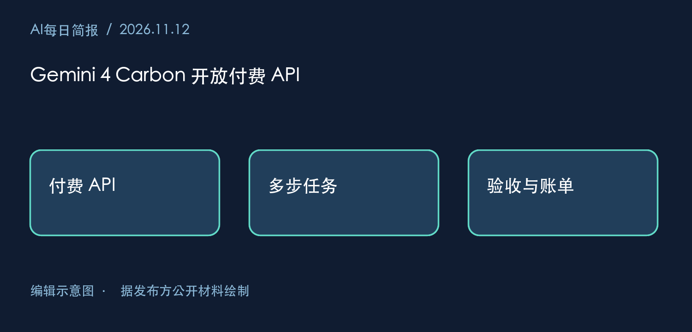
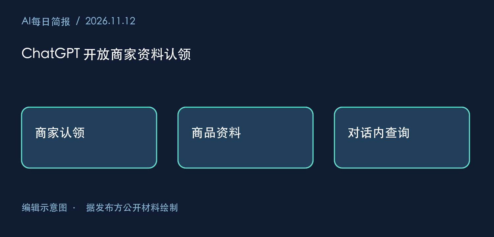
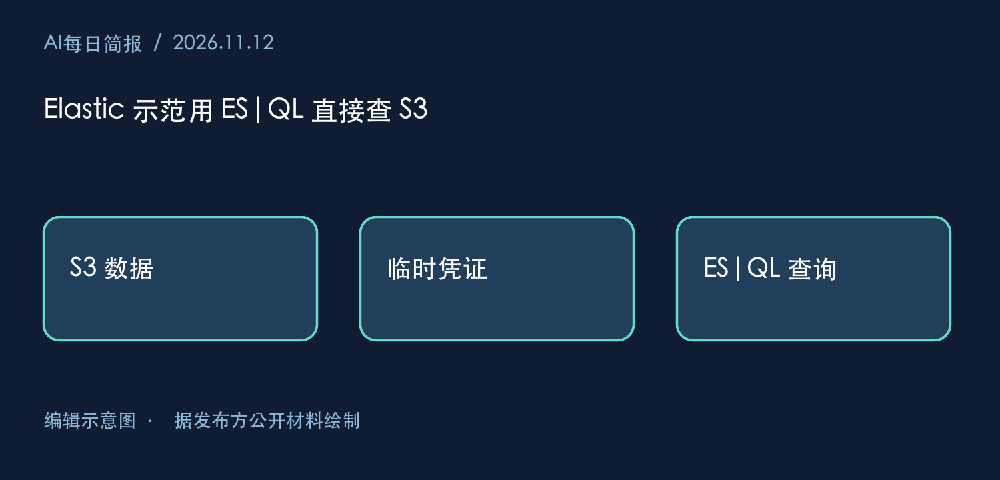
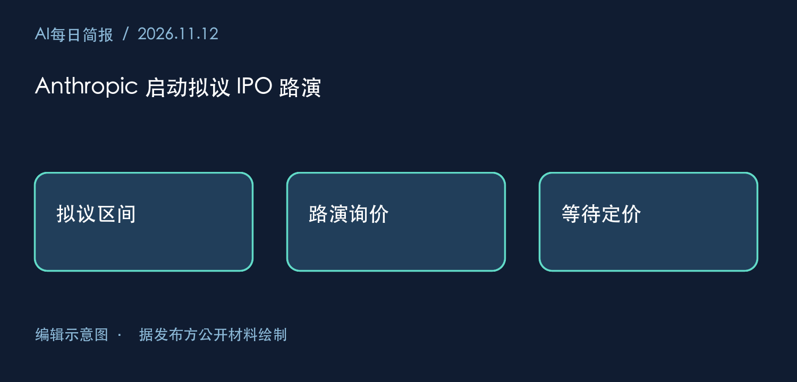
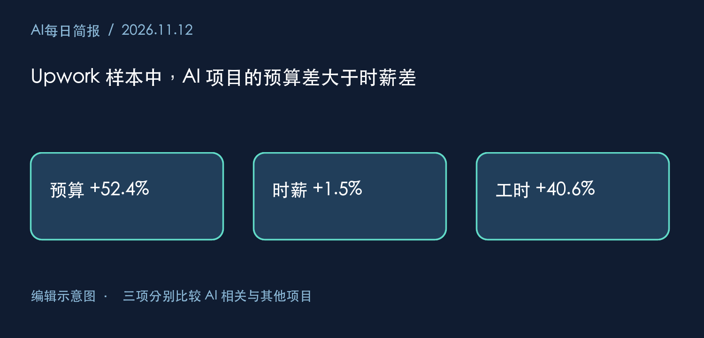

# 2026-11-12 AI 深度研究日报

## Part 1 · AI每日简报

### 2026-11-12 AI每日简报

北京时间资料截点 2026-11-12T07:03:47+08:00。本期最值得搜索团队关注的两项变化，是商家开始直接维护对话所用资料，以及 Elastic 示范直接查询留在 S3 的数据。两条路径都把答案质量的一部分交给了源数据的更新和权限管理。覆盖部分完成，16 个入口已读，连续窗口仍有缺口。

#### 1. Gemini 4 Carbon 开放付费 API

2026-11-10 · Google 开发者公告。Google 在 AI Studio 与 Android Studio 的付费 API 层开放 Carbon。Google AI Ultra 订阅者也可在 AI Studio 和 Antigravity 试用。 [一手原文](https://blog.google/innovation-and-ai/technology/developers-tools/gemini-4-carbon-developers/)

**为何重要**　开发团队可以把长任务放进现有测试集，观察模型能否从第一次工具调用走到最终验收。

**证据边界**　长程任务与网络安全能力属于 Google 的判断。不同权限、工具错误率和重试上限会改变完成率。

**下一项证据**　在同一代码库、工具权限与预算下，比较通过验收的任务数、重试次数和总账单。

#### 2. ChatGPT 开放商家资料认领

2026-11-10 · OpenAI 产品公告 · beta。符合条件的商家可以认领资料、维护商品信息并查看互动数据。首批 Business Agents 面向符合条件的美国电商和在线服务商。 [一手原文](https://openai.com/index/introducing-businesses-chatgpt/)

**为何重要**　当顾客在对话中询问价格或库存，商家多了一条直接维护答案所用数据的渠道。

**证据边界**　商家能维护资料，并不能保证回答总取到最新库存。互动量也无法单独说明成交。

**下一项证据**　对照商家源数据，记录一次改价何时反映到回答，以及缺货商品是否仍被推荐。

#### 3. Elastic 示范用 ES|QL 直接查 S3

2026-11-11 · Elastic 工程教程 · 技术预览。示例用同一套 FROM 语法查询 S3 上的 Parquet 数据。Elasticsearch 9.6 起默认启用这项技术预览，联邦身份通过 AWS STS 换取临时凭证。 [一手原文](https://www.elastic.co/search-labs/blog/query-amazon-s3-esql-data-federation)

**为何重要**　排查旧告警时，工程师可先查询留在 S3 的日志，省去为一次调查单独建立索引的步骤。

**证据边界**　教程用的是小型合成销售数据。真实扫描量、分区布局和跨区域流量都会影响响应时间与成本。

**下一项证据**　在相同日志分区上比较直接查询与预建索引的扫描字节数、P95 延迟及访问权限。

#### 4. Anthropic 启动拟议 IPO 路演

2026-11-10 · 发行人公告 · 官方索引列示日期。拟发行 8.25 亿股 A 类普通股，包含公司新发股份和现有股东出售的股份。预期每股 70 至 78 美元，公告称注册声明当时尚未生效。 [一手原文](https://www.anthropic.com/news/roadshow-launch)

**为何重要**　两类股份对应不同资金流向。公司只有在发行完成后才取得新股部分的净募集资金。

**证据边界**　区间与数量都可能调整，出售老股的所得归出售股东。当前材料不能确定最终定价、净募资或可用于算力的金额。

**下一项证据**　查最终招股书中的新股数、发行价、承销费用和资金用途，再核对交割公告。

#### 5. Upwork 样本中，AI 项目的预算差大于时薪差

2026-11-10 · OpenAI 与 Upwork 联合研究 · 作者披露。研究按工作类型与发布月份调整后，AI 相关项目的固定价预算高 52.4%，挂牌时薪高 1.5%。已雇用且工时为正的小时合同，前 90 天工时高 40.6%。样本截至 2026 年 4 月。 [一手原文](https://openai.com/index/ai-effect-on-freelance-work/)

**为何重要**　三个分母回答不同问题。较大的合同可以来自更多交付内容，即使同类小时报价变化很小。

**证据边界**　项目复杂度和雇主选择都可能影响分组。挂牌预算、挂牌时薪和实际工时来自不同口径，不能相乘推算个人收入。

**下一项证据**　跟踪同类项目的实际结算额、最终交付范围和重复雇用率，并在另一劳务平台复核。

#### 产品发布与技术更新
     
| 项目 | 阶段 | 接入与成本边界 |
|---|---|---|
| Gemini 4 Carbon | 开发者接入 | API 需付费，失败重试也影响每项完成任务的支出 |
| Businesses in ChatGPT | Beta | 商家资料认领与美国首批 Agent 有不同资格要求，公告未给出每次有效咨询成本 |
| ES&#124;QL Data Federation | 技术预览教程 | 9.6 起默认启用，需要配置 AWS 角色；示例没有实测大规模扫描费用 |

#### 深度分析

**谁能修正搜索答案里的旧数据？** ChatGPT 商家可以更新资料，但更新何时到达回答端仍待测。Elastic 的 S3 查询减少了一份可能过期的索引副本，但用户仍可能读到商家或日志系统尚未更新的源文件。对搜索团队而言，一次有判别力的测试是在源端改价或撤销权限，计时直到同一问题返回新答案或拒绝访问。如果慢在源端发布，缩短模型推理时间对这个问题帮助有限。

**怎样衡量 Agent 带来的工作量变化？** Carbon 的长任务能力主张与 Upwork 的工时数据看似方向相反，但两者的观测单位不同。模型可能更快完成一个步骤，而客户同时增加集成、测试和验收的范围。要区分效率提升与范围扩大，可以先固定交付范围测每次验收的总成本，再单列新增需求。两份材料均无法给出企业采用后的净收益。

#### 来源账本

| 范围 | 本次读到的内容 | 仍缺的证据 |
|---|---|---|
| OpenAI、Google-AI、Elastic、Anthropic | 官方索引及入选原文 | 未逐页闭合，Anthropic 首页焦点日期与条目日期分开处理 |
| AWS、Google-Cloud、Microsoft、NVIDIA | 公开索引；另读 AWS Agent Registry 同步教程 | AWS 教程缺原始发布日期，其余未核新正文 |
| TLDR-AI、TechCrunch、VentureBeat、EU-Startups | 四个发现入口、TLDR 11/11 单期及 TechCrunch 的 Fractile 报道 | Fractile 官方入口只查到旧一轮；欧洲融资金额待交易方新公告 |
| Singularity-Hub（周四） | 读到 11/11 模型自省评论，所引实验可追溯至 3 月 | 评论未当作当日实验结果 |
| TheSequence、First-Round-Review、Stratechery-Free | 补查前三个工作日的公开入口 | 免费候选正文及历史页未闭合 |
| CauseArtist | 周五轮读，本日未到期 | 保留旧缺口；备用来源未启用 |

本次未读到：Google-Cloud、Microsoft、NVIDIA、VentureBeat、EU-Startups、TheSequence、First-Round-Review、Stratechery-Free 的本期候选正文；Fractile 本轮融资的交易方公告。所有本期应查入口均已返回。各源 legacy 下界、连续覆盖和历史缺口见本次消费者来源快照。

旧事件复用见 2026-11-10-AI每日简报。同日的 2026-11-12-AI每日简报 对应 11 月 11 日槽位。外部读取 26 次，入选五项新事实，费用未知。采纳和效果待验证。

## Part 2 · AI深度研究

### 2026-11-12｜两个依赖名称能证明系统恰有两个依赖吗？

迁移评审会上，助手从服务目录查出支付系统依赖 A 和 B，于是写下“只要迁完这两个服务，依赖迁移就完成了”。工程师可以复核两条记录，却很难从记录本身复核“只要”。A 和 B 可能是同一服务在新旧注册中心的名称，目录也可能漏掉由配置文件动态加载的 C。

这里有两个独立问题。谁能证明两个名称指向不同对象？谁能证明当前范围内的清单已经列全？确认前者，可以提高依赖数的下界。确认后者，可以限制上界。工程上经常用去重处理第一个问题，再把去重结果当成第二个问题的答案。

#### 从类型继承到数量判断

在一个人员本体里，若已经声明每位经理都是员工、每位员工都是人，那么一个显式标为经理的个体也属于人。沿两条类关系即可解释这个结果。把条件换成“只有一个直属部门”，证据要求就变了。看到一条部门关系，还需要说明为什么第二个部门不可能存在。W3C 对 OWL 的说明给出了这个判断的依据。在开放世界假设下，一条关系没有记录，仍可能成立。一个结论要由已有公理推出，就必须在所有满足公理的解释中都成立。[W3C《OWL 2 Primer》](https://www.w3.org/TR/owl2-primer/)

Owlready2 的官方教程提供了可逐行检查的实例。作者在建立药品与成分的关系后，显式声明几种成分彼此不同，又对药品调用局部封闭操作，然后才运行推理机。前一步约束实体身份，后一步限制这些实例的关系取值。读者如果只看最后的重新分类输出，就会漏掉产生结论所需的数据准备。教程还说明，推理结果默认可放入单独的本体，使用上下文可以指定写入位置。做复核时，应同时保存输入公理和推得的类型，避免下次把上次推得的结果当作原始记录。[Owlready2 推理文档](https://owlready2.readthedocs.io/en/latest/reasoning.html)

#### 一个可以推翻“恰好两个”的小实验

本次实际用 Python 枚举了一组有限情形。固定观察值为“服务依赖 A，服务依赖 B”。允许两个名字指向同一对象，也允许存在一个未登记且与它们不同的依赖。每次只改变“确认异体”和“确认列全”这两个条件，计算相容情形中实际对象的个数。

| 已有证据 | 小实验中相容的对象数 | 助手可以据此怎么写 |
|---|---|---|
| 只有两条名称记录 | 1、2、3 | 目录列出两个名称，实际总数待核 |
| 清单列全，身份未核 | 1、2 | 至多两个对象，须核对别名 |
| 两者不同，完整性未核 | 2、3 | 至少两个对象，须查目录外依赖 |
| 两者不同且清单列全 | 2 | 在已确认范围内恰有两个对象 |

表中的 3 来自实验只允许一个额外依赖。对实际开放数据，缺少完整性承诺时，上界仍然未知。这个枚举的价值在于给出反例：同一份目录兼容两种不同的真实数量，就足以推翻“目录必然说明恰好两个”。本次只运行了有限枚举，未运行 HermiT 或 Pellet，也未用它衡量任何推理引擎的正确率。

#### 评审时该向谁取证

设想注册中心负责人能证明 A 和 B 的不可变服务标识不同。助手可以立刻把答案改为“已确认至少两个”，同时保留对动态配置的排查。如果运维随后提供版本锁定的依赖清单，还要问这份清单覆盖哪些环境、哪些调用方式和哪个时点。测试环境的完整记录，可以支持测试环境的迁移结论。线上允许插件运行时加载的事实，仍会改变生产环境的答案。

反过来，有些发布流程确实会生成完备的依赖清单。若构建过程能约束所有依赖的加载方式，产物带有版本，且资产登记能证明标识唯一，那么以计数回答同一构建范围内的问题完全合理。在这种场景反复给出“未知”，也会降低助手的可用性。好的验收样例要包含这一行，否则系统只需学会回避数量结论就能得高分。

昨天的问题是规则写在哪里、谁检查业务数据。今天的小实验补上一个更早的判断：即使关系都能被查询，现有事实究竟允许回答“至少”“至多”还是“恰好”？复测时可以固定两条输入，分别添加身份依据、完整性依据和二者，观察回答能否随新增证据准确收紧。若源材料只增加了又一张展示同样两条记录的截图，答案的上下界应保持原样。

**三分钟迁移题。** 某系统的组件清单里有两个名称。负责人确认本次离线镜像包含的依赖已全部登记，但无法确认这两个名称是否为别名。你会怎样写迁移说明？若随后拿到两个不同的稳定实体标识，哪一句可以改写？评分看三点：第一次能给出一到两个的范围，第二次能说明何以收紧为两个，两次回答都注明离线镜像版本和覆盖范围。

本次未读到：教程示例的独立推理机运行日志、生产系统的实体身份映射和清单完整性证明。
