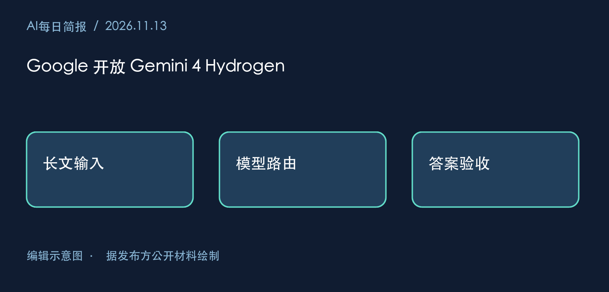
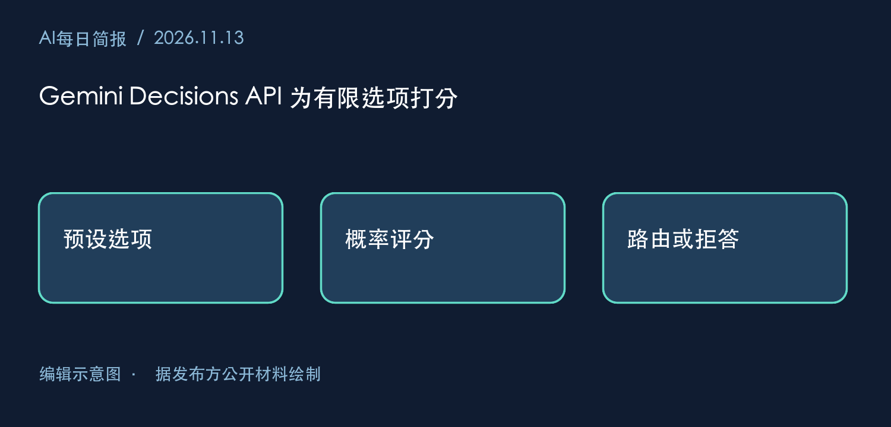
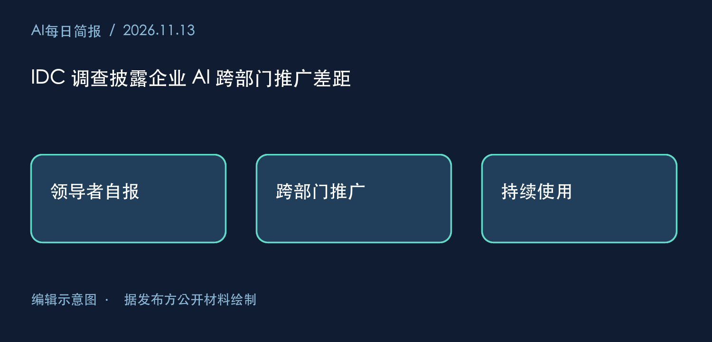
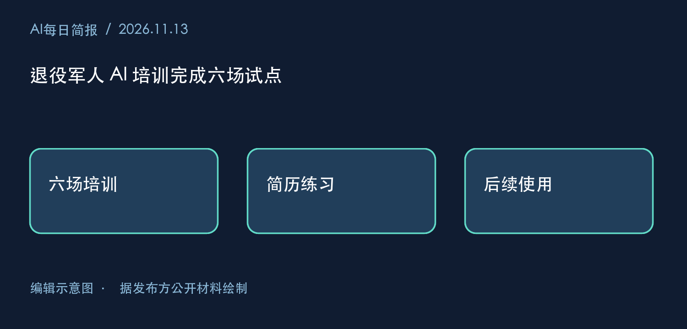
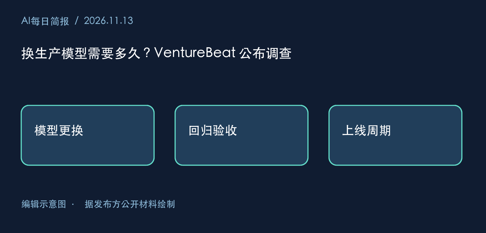

# 2026-11-13 AI 深度研究日报

## Part 1 · AI每日简报

### 2026-11-13 AI每日简报

北京时间资料截点 2026-11-13T07:31:35+08:00。Google 为多模型工作流增加了执行模型和专用决策接口。对准备迁移的团队，报价现在更清楚，生产验收需要多久仍取决于现有测试。13 个计划入口已检查，来源覆盖部分完成。

#### 1. Google 开放 Gemini 4 Hydrogen

2026-11-12 · Google 产品公告。Hydrogen 开始进入 Gemini API 和搜索。每百万输入、输出 token 分别为 1.50、7.50 美元，百万 token 上下文内采用同一档价。 [原文](https://blog.google/innovation-and-ai/models-and-research/gemini-models/introducing-gemini-4-hydrogen/)

**为何重要**　搜索团队可分别估算读入长材料和生成长答案的费用。

**不确定性**　厂商的编码基准无法预测企业搜索的引用准确率。

**下一项证据**　固定问题与检索结果，对比每个正确答案的总费用和延迟。

#### 2. Gemini Decisions API 为有限选项打分

2026-11-11 · Google 开发者公告。一个多模态输入可带最多 1,000 个独立问题，接口为预设选项返回概率。公告报价为每百万输入 token 0.10 美元，输出 token 免计费。 [原文](https://blog.google/innovation-and-ai/technology/developers-tools/gemini-decisions-api/)

**为何重要**　工具选择或文档相关性评分可以跳过生成长解释的步骤。

**不确定性**　漏列正确选项会让下游路由失效，高置信度也可能出错。

**下一项证据**　给测试集加入所有选项都不合适的请求，统计错路由率。

#### 3. IDC 调查披露企业 AI 跨部门推广差距

2026-11-12 · 微软赞助的 IDC 调查。微软披露 7 月调查结果（N=5,204）。66% 的受访领导者称 AI 已带来显著或变革性成果，48% 称价值已推广至多个业务单元。 [原文](https://blogs.microsoft.com/blog/2026/11/12/scaling-ai-value-without-losing-control-lessons-from-frontier-firms/)

**为何重要**　试点团队报告成效后，跨部门推广仍是单独的管理问题。

**不确定性**　自报结果和成熟度分组均受样本选择影响，无法据此计算企业 ROI。

**下一项证据**　跟踪同一批试点半年后的部署部门数、使用频率及停用原因。

#### 4. 退役军人 AI 培训完成六场试点

2026-11-11 · OpenAI 项目方回顾。OpenAI 披露与 Veterans Forge 完成首个六场 Academy 系列，为退役军人及军属提供培训，并展示用 ChatGPT 把军旅经历写进求职简历的案例。 [原文](https://openai.com/index/chatgpt-plus-for-veterans/)

**为何重要**　这个案例把账户可得性与学会完成一项具体任务区分开来。

**不确定性**　参训者自述和活动场次无法估计就业效果。

**下一项证据**　观察结课后独立修改简历的比例，以及持续使用情况。

#### 5. 换生产模型需要多久？VentureBeat 公布调查

2026-11-12 · VentureBeat 自有调查与采访。在表示公司换过生产模型的受访者中，70% 称迁移花了数周或更久。调查没有问哪些组件需要返工。 [原文](https://venturebeat.com/infrastructure/swapping-ai-models-is-easier-said-than-done-for-most-companies-it-takes-weeks-vb-intelligence-finds)

**为何重要**　在预算中只计新模型调用费，会漏掉提示词适配和回归验收的人力。

**不确定性**　样本只涵盖换过模型的受访者，具备任务级基准的团队可能换得更快。

**下一项证据**　看下一轮调查能否复现，并按任务复杂度及现有测试覆盖拆分周期。

#### 产品发布与技术更新

|项目|阶段与用途|适用范围及成本|
|---|---|---|
|Hydrogen|开始推出，用于搜索与 Agent 执行|API 输入、输出分别计费，长输出会改变总成本|
|Antigravity Orchestrator|Google 宣布在同一会话切换 Carbon 与 Hydrogen|公告列明 Antigravity 面向付费 Pro、Ultra 用户，基准配额降幅只适用于所测任务|
|Decisions API|开发者可用，用于闭集分类|上限 256K 输入 token，需预先定义候选项|

#### 深度分析

**选对模型以后，还要验什么？** Decisions 能在给定工具之间打分，Hydrogen 能执行所选步骤。但一次搜索失败可能出在两个地方：路由选错知识库，或者模型进入正确的库却引用了旧文档。把同一批失败请求分别固定路由、固定执行模型重跑，才能判断该改分类阈值、检索还是生成。仅看端到端平均延迟会掩盖这些差别。

**为什么有些团队换模型快，有些需要数周？** VentureBeat 采访中的 Uber 团队可以用历史代码变更检验代码审查 Agent。这提示一种解释：可重复的验收样本可能缩短迁移。另一种解释是单用途任务本就容易界定。微软披露的跨部门推广比例提示，扩大使用范围还会引入不同的权限与流程。可以分别记录技术回归和业务审批的天数，再判断哪一项决定上线日期。

#### 来源账本

|层级|本次覆盖|缺口|
|---|---|---|
|事实核验|Google-AI、Microsoft、OpenAI 读到入选原文；Anthropic、AWS、Google-Cloud、Elastic、NVIDIA 检查公开入口|各源历史分页及未选正文未闭合|
|新闻发现|VentureBeat 核对自有调查；TechCrunch、TLDR-AI、EU-Startups 检查入口|欧洲 Orakl 融资只见媒体列表，交易方公告待核|
|解释与反方|周五 CauseArtist 返回的缓存列有 9 月文章|无法验证 11 月当期内容；本期社会影响材料取自项目方|
|未到轮读日|TheSequence、First-Round-Review、Stratechery-Free、Singularity-Hub|既有缺口保留，备用来源未启用|

前期 Carbon 发布与商家认领可回看 2026-11-12-AI每日简报-v2。本期首次传输六个入口失败，经替代读取取得页面。有效新增事实按独立主条计 5 项，费用未知。来源断点详见本次消费者账本。

本次未读到：CauseArtist 当期内容，Anthropic、AWS、Google-Cloud、Elastic、NVIDIA、TechCrunch、TLDR-AI、EU-Startups 的当期候选正文，以及 Orakl 交易方原文。

## Part 2 · AI深度研究

### 2026-11-13｜写代码省下的时间，能换算成多少个岗位？

一项改动从讨论到发版只用了半天。最快的环节究竟是写代码、拍板，还是终于不用等另一个团队排期？三种解释都能产生同一个上线时间，对招聘却有完全不同的含义。

《晚点》采访魏小康时，他把十人左右的产研规模限定在产品复杂度较低、成员能兼做产品判断与全栈开发的应用公司。他还讲到一次两人商议后由一人迅速发版的经历。访谈能说明他看重怎样的团队，以及他认为哪些等待可以省掉。千万日活所需人力、长期值班负担、外部平台支持人数和同一业务由另一种团队开发的工期，采访中都缺少可比记录。[《晚点》访谈，按保存的文字核对](https://mp.weixin.qq.com/s?__biz=MzU3Mjk1OTQ0Ng==&mid=2247539862&idx=1&sn=5cf90666366386ee248c3da6408e6a74)

#### 同叫“开发效率”，计时从哪里开始？

Peng 等人在 2023 年的对照实验中给参与者同一项任务，用 JavaScript 实现一个 HTTP 服务器。论文摘要报告可用 Copilot 的组完成任务快 55.8%。这为明确需求下的实现加速提供了实证。实验开始时产品方向和交付对象已经给定，因而这个数值无法告诉我们一个团队要花多少时间识别用户需求、审查改动或处理故障。[作者论文摘要](https://arxiv.org/abs/2302.06590)

METR 在 2025 年选择了另一类工作。16 位资深开发者带来他们熟悉的大型开源仓库中的 246 项实际任务，每项随机决定是否允许使用 AI。允许使用当时工具的任务平均用时长了 19%。开发者熟悉既有实现，新代码还要满足项目规范；复核生成内容可能抵消少打字的收益。这是一种可检验的解释，单凭平均用时无法量出复核贡献了多少。[METR 的实验方法与结果](https://metr.org/blog/2025-07-10-early-2025-ai-experienced-os-dev-study/)

两项研究的任务、工具年代、参与者与验收条件都变了。将两个百分数相减，无法估计“成熟项目的惩罚”。评估某个具体团队时，值得借用的是随机分配前先定义任务、在同一种验收口径下计时的做法。

#### 最有可能受益的人为什么没有出现在数据里？

METR 于 2026 年 2 月说明，后续研究中，一些开发者不愿承受禁用 AI 的机会成本，另一些开发者只提交自己愿意徒手完成的任务。同时运行多个代理也让每项任务的工时难以分摊。作者判断新数据给出的提速幅度很不可靠。这个反例同样适用于企业内部试点。只看主动提交的成功演示，容易高估收益；要求所有入组者都愿意停用工具，又可能漏掉受益最大的工作。[METR 对选择偏差的分析](https://metr.org/blog/2026-02-24-uplift-update/)

#### 用一次上线区分两种解释

假设一项改动原来经历实现、等评审、修复与发布四个串行环节，各耗 2、5、1、2 天。如果只把实现减半，交付从 10 天变成 9 天；如果评审等待从 5 天减至 1 天，即使编码速度不变，也可在 6 天交付。这是算例，数字均为假设。若团队把等候时间算成人员工时，会同时高估成本节省和可减少的人数。

下一轮可以先登记全部候选需求及排除原因，按新建功能和既有系统改动分层。在权限与人员构成相同的条件下，对可比较任务分配工具使用条件，计入失败、放弃与返工。分别记录工程师主动工时、评审队列等待、端到端交付时间和上线后缺陷。并发任务记录同一人的总工时，另记机器运行时长。若交付变快主要来自等待缩短，再独立试验把决策权交给实现者。这样才有机会判断下一次投入应落在工具、评审能力还是授权上。本期完成了来源核对，这项团队实验尚待实施。

**三分钟迁移题**　内部搜索团队用 AI 生成索引迁移脚本后，实现时间减半，发布仍需两周。负责人准备据此削减一半编制。请列出至少两个缺失的分母，并设计一项能推翻该决定的观测。合格回答应指出实现占总人工投入的比例、该类任务占团队工作量的比例，并用一次包含回滚演练、权限审查和上线缺陷的同口径比较说明判断将如何改变。

本次未读到：访谈所涉企业的团队名册、同业务对照工时、值班与外包记录，以及论文的逐任务原始数据。上述证据支持设计测量，尚不足以给出某家公司的理想编制。
