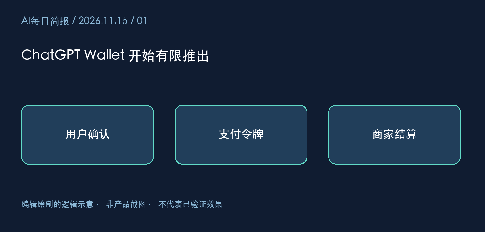
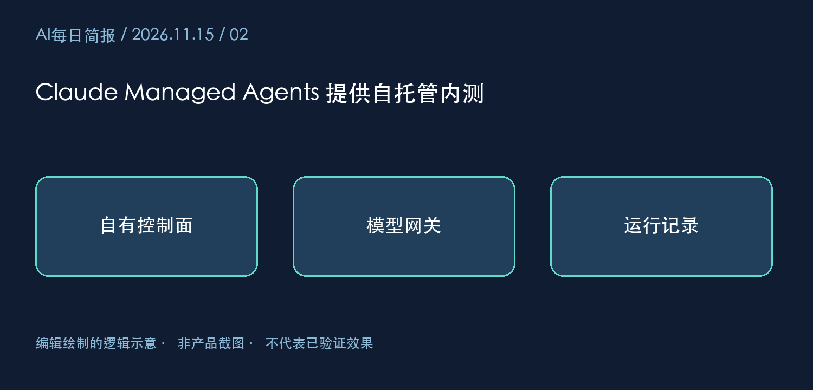
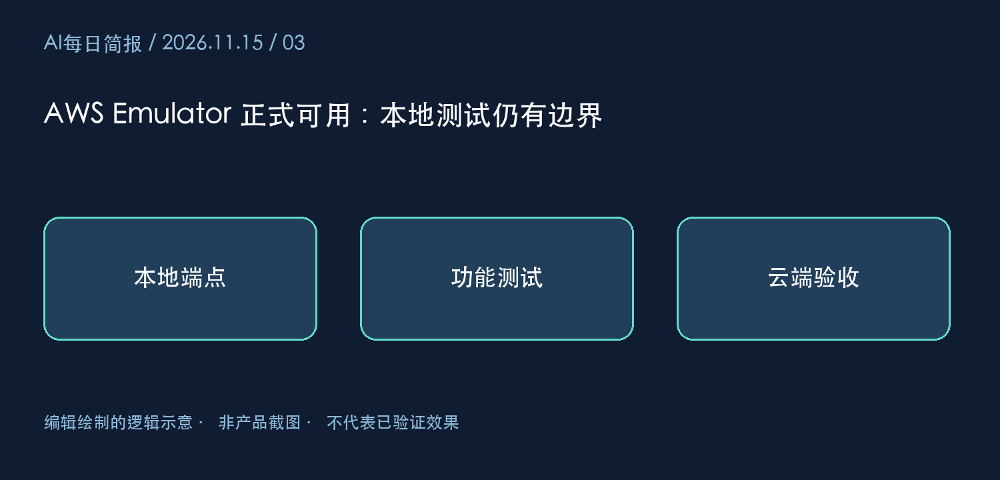
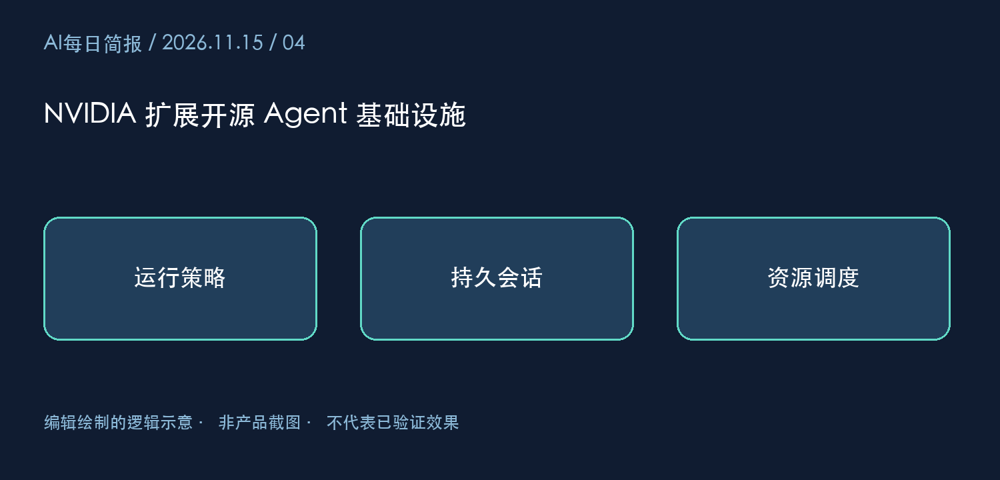
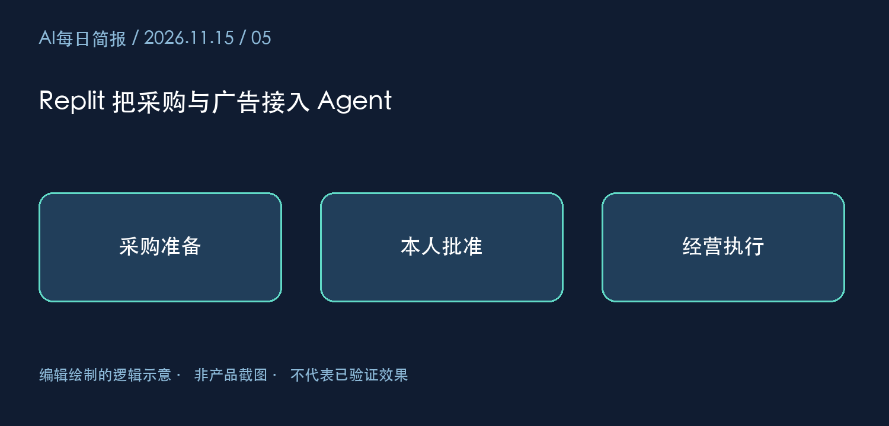

# 2026-11-15 AI 深度研究日报

## Part 1 · AI每日简报

### 2026-11-15 AI每日简报

资料截点（北京时间）：2026-11-15T07:40:23+08:00。状态：部分完成。五条原文核验，含两条明确标记的本周补读；覆盖窗口尚未闭合。本期增量集中在 Agent 的支付授权与运行控制，尚不能推导商业收益。

#### 1. ChatGPT Wallet 开始有限推出

2026-11-13 · 厂商一手公告。[原文](https://openai.com/index/introducing-chatgpt-wallet/)

**事实**：OpenAI 宣布面向美国成年 Pro 用户在 dots 中逐步推出，支持符合条件的美国发行卡；每次购买须用户确认并完成安全检查，Agent 使用支付令牌。

**为何重要**：搜索到购买的链路增加了明确的授权步骤。

**反方／不确定性**：可用范围有限；网站风控仍可能拒付，不能据此推算转化率。

**下一项证据**：观察实际拒付率、授权记录与退款处理。

#### 2. Claude Managed Agents 提供自托管内测

2026-11-12 · 厂商一手公告。[原文](https://claude.com/resources/articles/self-hosted-claude-managed-agents)

**事实**：Anthropic 宣布 private beta：企业可运行服务端、数据库与工作节点，会话历史留在自有数据库；模型请求仍发送至所选服务商或网关。

**为何重要**：企业可以分别控制运行环境和模型请求路径。

**反方／不确定性**：自托管控制面不等于模型离线部署；运维成本与正式报价本次未核实。

**下一项证据**：检查出站流量、密钥隔离和断线恢复行为。

#### 3. AWS Emulator 正式可用：本地测试仍有边界

2026-11-11 · 厂商一手公告。[原文](https://aws.amazon.com/blogs/aws/test-your-applications-against-aws-locally-with-aws-emulator/)

**事实**：本次补读：AWS 宣布 Emulator GA，SDK 与 CLI 可连接本机端点，无额外服务费；macOS 和 Windows 使用 Docker。

**为何重要**：编码 Agent 可在部署前迭代验证云 API 调用。

**反方／不确定性**：官方明确不按真实 AWS 方式评估 IAM；本地通过不能证明生产权限正确。

**下一项证据**：核对所用服务的 fidelity 分数，并在隔离云环境验证权限。

#### 4. NVIDIA 扩展开源 Agent 基础设施

2026-11-10 · 厂商一手公告。[原文](https://blogs.nvidia.com/blog/open-source-openshell-infrastructure/)

**事实**：本次补读：NVIDIA 宣布向 CNCF 贡献 OpenShell，并推进与 Agent Substrate 集成；NVKE 和 Kubernetes Recipes 为 public preview。

**为何重要**：运行权限、持久会话和资源调度开始有可组合组件。

**反方／不确定性**：社区治理和安全收益仍需独立验证；预览组件不代表生产成熟。

**下一项证据**：观察 CNCF 项目记录、兼容矩阵及故障恢复测试。

#### 5. Replit 把采购与广告接入 Agent

2026-11-12 · 厂商一手公告。[原文](https://replit.com/blog/replit-agent-ads-commerce)

**事实**：Replit 宣布通过 Link、Visa 支持美国 Core 与 Pro 用户的一次性采购；付款前确认总额。Google Ads 功能向全球 Pro 用户提供。

**为何重要**：创业工具从构建应用延伸至经营流程。

**反方／不确定性**：厂商客户案例不能证明普遍收益；广告费和实际获客效果需要单独核算。

**下一项证据**：观察付款审批失败处理及广告带来的可归因转化。

#### 产品发布与技术更新

|项目|阶段|范围与成本限制|
|---|---|---|
|ChatGPT Wallet|有限推出|美国成年 Pro 用户及合资格卡；本次未核验完整费用表|
|Claude 自托管 Managed Agents|Private beta|需申请；自有基础设施及模型调用成本另计|
|AWS Emulator|GA|无额外服务费；云端部署资源收费，不替代 IAM 验收|
|NVKE / Kubernetes Recipes|Public preview|GPU 基础设施组件；本次未执行部署|
|Replit 采购／广告|已宣布可用|采购限美国一次性交易；广告限 Pro，广告预算另计|

#### 深度分析

**分析推断：授权正在成为 Agent 产品的组成部分。** Wallet 与 Replit 都把付款前的人类确认放进流程，Claude 与 OpenShell 则把策略、凭证和执行环境分开。共同问题是：模型选出的行动是否被允许执行，以及失败后能否追查。两类方案服务的场景不同，不能据此判断哪一家安全性更高。

**替代解释与验证：更多控制也可能只是把成本转移给运维。** 自托管增加数据库、网络与升级维护；本地模拟减少云端迭代，却不能覆盖真实 IAM 行为。要比较投入，需分别记录每个成功任务的模型费、人工审核时间、环境维护和失败恢复成本。当前公告没有给出同口径数据，不能计算 ROI。可以先选一个只读检索任务和一个需审批的写入任务做对照。

本期未新增欧洲或独立社会影响结论。欧洲入口读取失败；周日不强制新增轮读源，旧轮读积压继续保留。

#### 来源账本

|来源|本次读取|未闭合范围|
|---|---|---|
|OpenAI|索引及 Wallet 正文|历史分页与未选正文|
|Anthropic|新闻索引及自托管正文|历史窗口；模型发布未重报|
|Google-AI|公开入口|候选正文未读；11/13 已报内容链接复用|
|AWS|索引及 Emulator 正文|服务级能力未实测，历史分页未闭合|
|Google-Cloud|入口超时|当期及历史窗口未读|
|Elastic|索引与版本发布页面返回|版本细节未完成核验|
|Microsoft|索引|未选正文未读|
|NVIDIA|索引及 OpenShell 正文|其他候选、历史窗口未闭合|
|TechCrunch|索引|候选正文未读，不以标题下结论|
|TLDR-AI|11/13 期及两条外链|其余链接未核验|
|VentureBeat|索引|当期原始证据未读|
|EU-Startups|403|当期与历史窗口未读|
|五个轮读源|周日不强制新增|既有缺口保留；本周未完成线索不视为覆盖|

Replit 为 TLDR 事件的一手回查，未新增常设订阅。未启用其他候选库。所有连续覆盖边界、legacy 下界和历史缺口保留；未以今日索引替代完整窗口。

复用：11/13 简报、11/14 缺口短稿。本次不重复 Hydrogen、Decisions 与模型迁移调查。

本次未读到：Google-Cloud、EU-Startups，以及 Google-AI、Elastic、Microsoft、TechCrunch、VentureBeat 当期候选正文；各源历史分页和轮读积压未闭合。

验收：五新闻五图；图片为离线编辑示意，不是产品实测。来源覆盖部分完成，采纳 unknown、效果 unverified。外部 web 调用 7 次；有效新事实按入选独立事件计 5 项；费用 null。工具未提供可设置的原生超时，此项执行约束未满足。begin 在完成槽位核验后建立，未满足第一批即建立回执的时序要求；预算仍从应用会话开始累计。

## Part 2 · AI深度研究

### 把一次成功变成可复用 Skill，需要跨过哪些测试

这是 11 月 15 日期次的补稿，11 月 16 日形成草稿，11 月 17 日复核作者原页并完成编辑。材料来自此前科研 Agent 课程线索。本期接着追问：如果昨天的脚本已能算对结果，把步骤写进 Skill，是否就获得了可迁移能力？本稿提出测试设计，没有安装、运行或认证任何 Skill。

核心判断是：自然语言触发、输入适配和结果正确是三个不同验收对象；旧会话中的成功可能依赖未写入文件的上下文；复用价值应按重复任务的净成本衡量，不能用生成的 Skill 文件数量衡量。

#### 一手材料把“写出来”和“用起来”分开

课程 Module 3 Lab 的 Part C 要求在新会话里用不点名工具的自然请求测试 Skill，再以未参与构建的两个公司输入检查输出结构。这是作者设计的教学验收动作，说明触发和迁移需要证据；两个输入通过并不能建立跨行业可靠性的统计保证。[课程实验原页](https://johnmbarrios.com/claude-code-accounting/labs/day3.html)

我同意移走旧会话这一测试条件。聊天中临时确认的列名、目录、异常处理和年份约定，可能从未进入可复用文件。保留原会话测试，相当于让考生带着只在训练时存在的答案提示。但新会话失败也未必表示流程无效：权限缺失、依赖版本不同和输入不可得都可能导致失败。因此，复测时必须记录环境条件，不能把全部错误归于描述字段。

#### 为触发与执行分别设置对照

下面是本文提出、尚未实施的小型测试。先固定输出验收标准，再准备三类请求：应当调用该流程的自然表达、词面相近但任务不同的负例，以及信息不足的请求。分别观察触发、拒绝和澄清行为。若只测试显式输入 Skill 名称，能证明它可以被调用，却无法证明系统知道什么时候该调用。

执行阶段再换输入，不把换问题和换环境同时进行。保持依赖及权限不变，只替换文档结构或业务对象；之后单独改变环境。否则，新输入失败时难以判断是数据适配问题还是环境缺失。未见样本应在流程定稿前预留；如果每次失败都修改流程并反复使用同一测试样本，该样本已经成为开发材料，应再加入新的保留样本。

一个容易忽略的负例是“相同表头、不同含义”。例如原流程按发票开具日期汇总，迁移后的表格同样有 date 列，却代表付款日期。文件可以生成、总额也可对上，但月份归属已经改变。可复用流程需要声明每一行是什么、日期字段意味着什么、允许什么缺失值。测试不能只比较文件名和表头。

|测试层|要回答的问题|看似成功但不足的证据|有辨别力的下一步|
|---|---|---|---|
|触发|该用时是否调用|显式点名工具后运行|自然表达加相近负例|
|输入|是否理解参数语义|字段名称相同|更换同名异义字段并观察拒绝或澄清|
|执行|能否在规定条件复现|旧聊天重跑成功|新会话与固定依赖复测|
|结果|是否满足业务含义|输出结构一致|独立算例与原始记录抽查|

#### 最强反例：通用流程可能比一次性脚本更贵

如果某项任务只发生一次，输入不断变化，或者人工判断无法稳定表达，把它打包成 Skill 可能增加维护负担。描述、依赖、示例和测试都要随变化更新。一个明确记录输入输出的一次性脚本，可能更容易审查。因此，“能封装”不等于“值得封装”。

可以按一次迁移记录真实投入：准备、运行、审查、修正和环境维护各花多少主动工时；另记等待时间和机器运行费用。再与同任务的现有做法比较。若只是把操作时间转移成维护时间，总耗费未必下降。这与前一期团队效率分析相连：都需要明确分母，不能把一个局部环节的加速外推为组织收益。

#### 三分钟迁移题

一个报表 Skill 在旧聊天中十次成功，在新会话里生成的金额总数正确、月份分布却错误。你会先改触发描述还是字段解释？请给出一项可区分两者的检查，并说明哪类测试应保留为未见样本。合格回答应先确认确实加载了目标 Skill，再核对日期语义；不能仅凭最终文件存在就判定迁移成功。

本次未读到：课程 Skill 实际运行轨迹、完整附件、未见公司测试结果及长期维护记录。本文使用一手教学设计提出工程验证方案，不宣称复用成功率或成本节省。理解未验证。
